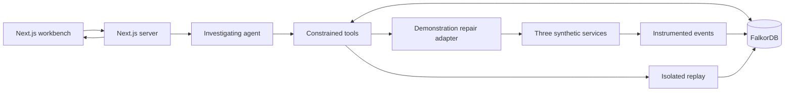

# Architecture notes and graph sketch

These are conceptual planning notes. Exact schemas, endpoints, query syntax, and implementation structure should be finalized during the event.

## Selected technology

| Responsibility | Proposed choice | Purpose |
| --- | --- | --- |
| Application | Next.js App Router + TypeScript | Interface and backend in one language |
| UI components | Tailwind CSS + shadcn/ui | Consistent controls and readable panels |
| Graph interface | React Flow | Explore workflow paths and highlighted evidence |
| Server endpoints | Next.js Route Handlers using Node.js | Receive events and run bounded operations |
| Primary storage | FalkorDB JavaScript client | Store and query connected operational context |
| Agent | One model with structured tool calls | Investigate, choose tools, and explain evidence |
| Replay engine | Deterministic server-side TypeScript | Compare executable repair outcomes |
| Startup | Docker Compose | Reproduce the application and FalkorDB locally |

Official references: [Next.js Route Handlers](https://nextjs.org/docs/app/api-reference/file-conventions/route), [FalkorDB](https://docs.falkordb.com/), and [React Flow](https://reactflow.dev/).

Database credentials and model keys stay on the server. The graph interface receives only the information needed to display a run. A persistent TypeScript worker may be added if hosting or execution duration requires it; it is not an MVP prerequisite.

## Conceptual flow

## Separate topology from execution history

Workflow topology can be cyclic. Causal event history should consist of distinct event instances with parent links; repeated traversal of the same workflows must not be represented by making an event its own ancestor.

- **Topology:** which workflows observe which resources and write to which systems.
- **Execution:** which actual action produced which actual event, in which run and configuration revision.
- **Evidence:** observed return paths, repeated business versions, and delivery failures.
- **Repair history:** proposed configuration changes and their replay results.

This distinction helps detect repeated execution without incorrectly treating every cyclic topology as a runaway loop.

## Proposed node types

| Node | Represents |
| --- | --- |
| System | A synthetic business service |
| Workflow | A trigger/action rule with a configuration revision |
| Record | A business object; always scoped to a run |
| Event | One event instance, including originating change and parent metadata |
| Action | One attempted write or delivery |
| Goal | A required business outcome for a scenario |
| Investigation | A bounded agent investigation and its outcome |
| Repair | A supported configuration change or small change set |
| Replay | An isolated candidate execution with measurements |

Relationship sketches: workflows observe systems and write records; events trigger actions; actions emit new events; actions update records; investigations reference evidence; repairs modify workflows; replays evaluate repairs against goals.

Every node and query is scoped to an environment and run. Replayed candidate state must remain isolated from the baseline and other candidates.

## Essential graph questions

1. Which workflow/action/event path returned a change to a system it had already visited?
2. Did that return produce new business state, or repeat an existing version?
3. Which other workflows and required outcomes depend on the proposed repair location?
4. Which supported guards could prevent repeated effects while keeping the required deliveries?
5. Which candidate replay results satisfy the declared goals?

Implement these through FalkorDB queries and bounded application analysis of their results. The primary graph must supply the operational evidence; a hard-coded scenario answer is not acceptable.

## Agent responsibility

Suggested tool capabilities: inspect the run, trace event ancestry, inspect affected goals, propose a supported repair, replay a candidate, compare results, apply a verified repair, and check the new run.

The model chooses investigations and explains evidence. Deterministic code checks tool arguments, repair eligibility, configuration versions, and observed replay outcomes. Do not accept a model's assertion that a repair passed as verification.

## Repair constraints

- Use a fixed catalog of supported operations; do not execute arbitrary model-generated code.
- Deduplicate by originating change and intended operation, not permanently by customer ID.
- Meaningful later edits receive distinct originating change identifiers.
- Preserve lineage across supported adapters; missing lineage is an explicit limitation.
- No-op detection compares business fields, not incidental transport timestamps.
- Apply a repair only to the revision that was replayed; a changed revision requires another check.
- Rank only eligible candidates. Prefer goal preservation, then fewer edits and lower declared disruption.
- Say "best among evaluated candidates" unless the bounded search exhaustively evaluated its complete supported candidate space.

## Execution boundaries

Bound every simulation and investigation by action count, time, and model-tool-call budgets. A pre-repair scenario may be halted by a safety budget; report it as halted rather than naturally terminated. Persist completed evidence so a page refresh can reconstruct the report. On graph or model failure, show an interrupted investigation; do not claim a successful repair.
